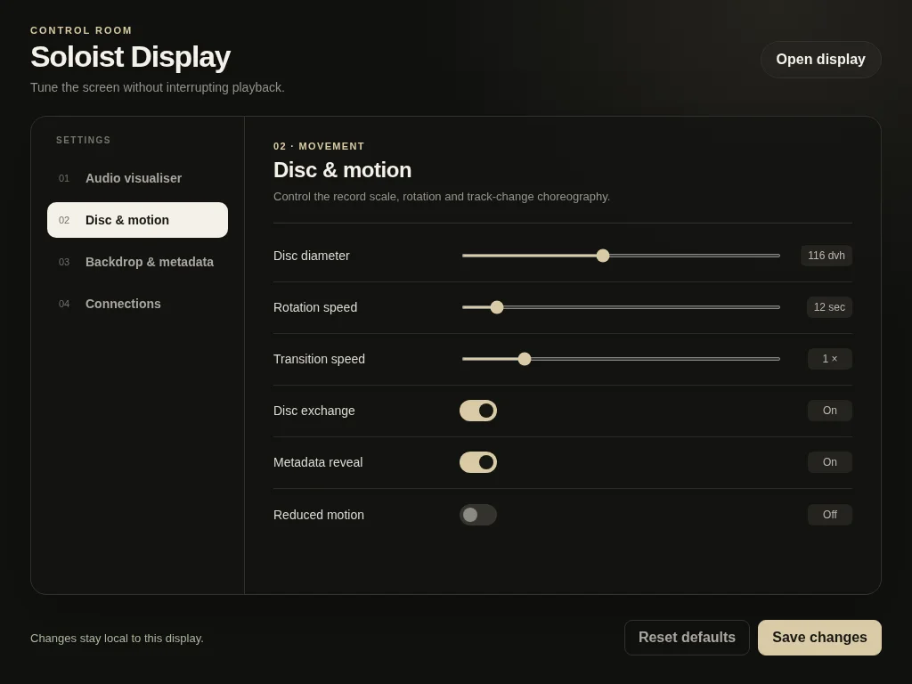

# Soloist Display


A minimal, CRT-friendly now-playing screen for [Spotify Soloist](https://developer.spotify.com/documentation/soloist), with album art, track progress and a live audio spectrum.

> **Already have Soloist running? Skip to [Step 3](#3-install-soloist-display).**

## 1. Prepare Arch Linux

From a fresh installation:

```sh
sudo pacman -Syu
sudo pacman -S --needed base-devel git curl firefox pipewire pipewire-pulse wireplumber libpulse rofi nano
```

## 2. Install Spotify Soloist

Soloist needs Spotify Premium and a private API key. Generate yours in the [Spotify for Developers dashboard](https://developer.spotify.com/dashboard/soloist), then install the official x86_64 Linux build:

```sh
mkdir -p "$HOME/Downloads/soloist"
cd "$HOME/Downloads/soloist"
curl --fail --location -o soloist.tar.gz https://soloist-builds.spotifycdn.com/soloist_release_x86_64.tar.gz
tar -xzf soloist.tar.gz
install -Dm755 soloist "$HOME/.local/bin/soloist"
"$HOME/.local/bin/soloist" --version
```

Clone this repository and install its Soloist user service:

```sh
git clone --branch feat/now-playing-display --single-branch https://github.com/jedrek0429/soloist-display.git "$HOME/soloist-display"
install -Dm644 "$HOME/soloist-display/packaging/soloist.service.example" "$HOME/.config/systemd/user/soloist.service"
install -Dm600 /dev/null "$HOME/.config/soloist/env"
nano "$HOME/.config/soloist/env"
```

Add your device name and key:

```ini
SOLOIST_NAME="ThinkCentre CRT"
SOLOIST_API_KEY="PASTE_YOUR_KEY_HERE"
```

Start Soloist:

```sh
systemctl --user daemon-reload
systemctl --user enable --now soloist.service
```

In Spotify, open **Connect to a device** and choose the value of `SOLOIST_NAME`. Soloist Display expects Soloist's WebSocket at `127.0.0.1:9090`.

## 3. Install Soloist Display

If you skipped Step 2, clone the repository first:

```sh
git clone --branch feat/now-playing-display --single-branch https://github.com/jedrek0429/soloist-display.git "$HOME/soloist-display"
```

Build and install:

```sh
cd "$HOME/soloist-display"
makepkg -si
```

Open Rofi with `rofi -show drun`, then choose **Soloist Display**. Choose **Soloist Display Settings** to adjust its appearance.



Settings are stored in `~/.config/soloist-display/config.json`.

## Troubleshooting

```sh
systemctl --user status soloist soloist-display
journalctl --user -u soloist -u soloist-display -n 50
pactl get-default-sink
```

Soloist builds expire after 90 days; replace the binary with a current [official download](https://developer.spotify.com/documentation/soloist/reference/downloads-and-updates).
